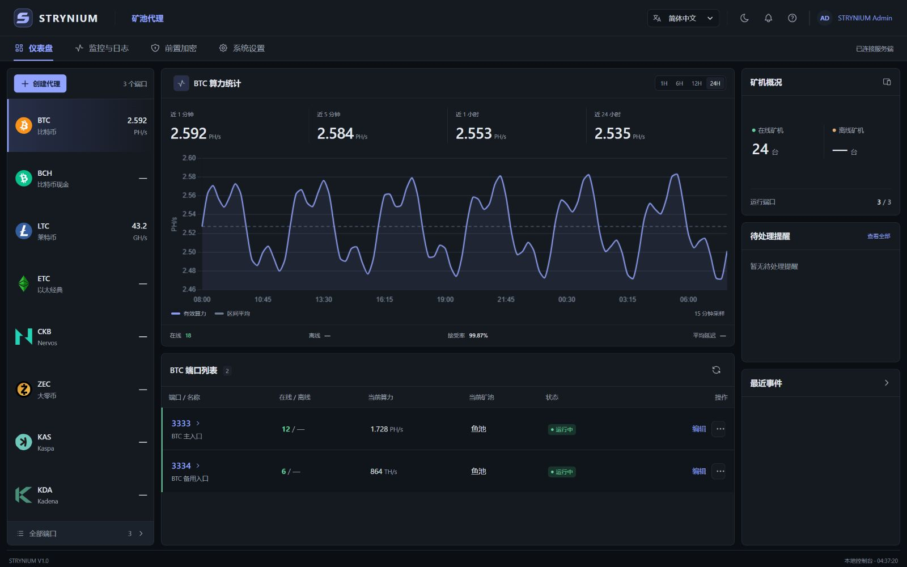
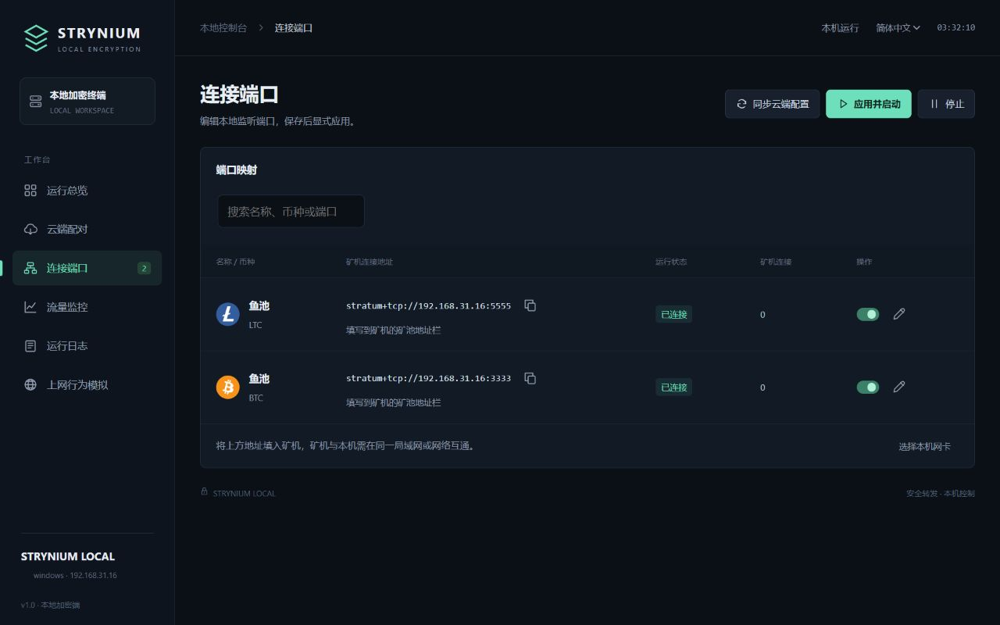

<div align="center">
  
  <h1>STRYNIUM</h1>
  <h3>矿池代理与本地加密连接</h3>
  <p>矿机在本地接入，端口与矿池集中管理。<br>让矿场到服务端的连接更清晰、更易维护。</p>
  <p><strong>服务端 R17 · 本地加密端 D12 · Windows / Linux / Ubuntu x64</strong></p>
  <p><a href="#downloads">软件下载</a> · <a href="#install">一键管理</a> · <a href="#start">配置教程</a> · <a href="#screens">界面预览</a> · <a href="#docs">使用文档</a></p>
</div>

> **当前发布：服务端 R17 / 本地加密端 D12 · 2026-10-31**<br>

**STRYNIUM Miner** 面向矿场的矿机接入与矿池代理场景。服务端提供统一管理控制台，本地加密端部署在矿机所在网络，两端配合完成授权连接和矿机转发。

```text
矿机 → 本地加密端 → STRYNIUM 服务端 → 矿池
```

<a id="downloads"></a>
## 下载与版本

按运行环境选择软件。**服务端**与**本地加密端**分别打包、分别更新。

| 组件 | 系统 | 格式 / 体积 | 当前构建 | 软件包 |
| :--- | :--- | :--- | :--- | :--- |
| **服务端** | Windows x64 | `ZIP` · 4.62 MiB | R17 | [下载](https://github.com/strynium/strynium-miner/releases/download/v1.0.0-r17-d12/STRYNIUM-Server-Windows-x64-R17.zip) |
| **服务端** | Linux x64 | `tar.gz` · 4.72 MiB | R17 | [下载](https://github.com/strynium/strynium-miner/releases/download/v1.0.0-r17-d12/STRYNIUM-Server-Linux-x64-R17.tar.gz) |
| **服务端** | Ubuntu x64 | `DEB` · 3.87 MiB | R17 | [下载](https://github.com/strynium/strynium-miner/releases/download/v1.0.0-r17-d12/strynium_1.0.0+20261031.r17_amd64.deb) |
| **本地加密端** | Windows x64 | `ZIP` · 2.50 MiB | D12 | [下载](https://github.com/strynium/strynium-miner/releases/download/v1.0.0-r17-d12/STRYNIUM-Local-Windows-x64-D12.zip) |
| **本地加密端** | Linux x64 | `tar.gz` · 2.01 MiB | D12 | [下载](https://github.com/strynium/strynium-miner/releases/download/v1.0.0-r17-d12/STRYNIUM-Local-Linux-x64-D12.tar.gz) |
| **本地加密端** | Ubuntu x64 | `DEB` · 1.68 MiB | D12 | [下载](https://github.com/strynium/strynium-miner/releases/download/v1.0.0-r17-d12/strynium-local_1.0.0+20261031.d12_amd64.deb) |

体积为下载文件大小，单位 MiB。Linux / Ubuntu 本地端解压后约 **4.97 MiB**，不附带完整浏览器。

[SHA-256 校验文件](https://github.com/strynium/strynium-miner/releases/download/v1.0.0-r17-d12/SHA256SUMS.txt) · [发布清单与验证范围](https://github.com/strynium/strynium-miner/releases/download/v1.0.0-r17-d12/STRYNIUM-R17-D12-MANIFEST.json) · [校验方法](VERIFY.md)

> GitHub 自动生成的 **Source code (zip / tar.gz)** 是此文档仓库的归档，不是可运行的软件安装包。请选择上表中的组件包。

本次 R17 修复旧任务拒绝与抽水切换、结果不明时的连接恢复。**本地端 D12 软件包保持不变，无须重复更新。** 验证范围与现场测试限制见 [R17 / D12 验证说明](docs/RELEASE_R17_D12.md)。

<a id="install"></a>
## 一键安装与管理

**云服务器通常只安装「服务端」；矿场电脑安装「本地加密端」。** 云服务器选择 Linux / Ubuntu x64 系统后，可直接在云厂商网页里的远程终端操作，不需要先学习 Linux 命令。

1. 在云厂商控制台找到这台服务器，打开「远程连接 / 登录终端」。
2. 复制下面**这一行命令**，粘贴到终端并回车。脚本自动检查并准备所需组件，已安装的直接复用。
3. 菜单选择 **1 服务端 → 1 安装 / 更新**，脚本自动识别服务器公网 IPv4，无需手动填写。安装结束会显示访问地址和初始账号密码，之后用浏览器管理。

```bash
bash <(curl -fsSL https://github.com/strynium/strynium-miner/raw/main/install.sh)
```

使用普通账号时会自动申请管理员权限；如果提示密码，输入当前 Linux 登录账号的密码即可。root 登录可直接运行。后续管理只需：

```bash
strynium-manage
```

<details>
<summary>系统兼容要求（通常无需手动处理）</summary>

一行入口使用 Bash 和 curl，通过 HTTPS 下载脚本；极简系统缺少 curl 时，参见 [安装说明](INSTALL.md#entry-troubleshooting)。管理器使用 Python 3.8+ 和系统自带的 systemd。下载工具、运行环境、CA 证书等缺失时会从系统软件源自动安装；无需用户逐项安装。过旧系统、没有 systemd 的容器和未知软件源不会被强行修改，脚本会说明原因；可参考 [手动安装说明](INSTALL.md)。不自动升级或重装操作系统。

</details>

| 管理操作 | 已支持 |
| :--- | :--- |
| 安装 / 更新 | 下载并校验最新正式软件包，备份配置，检查运行状态；失败时恢复原版本与数据 |
| 启动 / 停止 / 重启 | 分别管理服务端、本地加密端；本地端重启后仍须在控制台解锁并启动转发 |
| 修复公网访问地址 | 自动识别并修复旧安装的仅本机访问配置，保留现有端口和数据 |
| 修改 Web 端口 | 检查端口占用，修改服务端 Web 端口并显示新地址 |
| 重置账号密码 | 交互重置服务端控制台账号密码，保留两步验证、矿机与抽水配置 |
| 状态 / 日志 / 诊断 | 版本、进程、控制台健康检查及隐藏会话密钥的日志 |
| 打开控制台 | 显示服务端地址或本地端当前会话登录链接 |
| 卸载 | 停止所选组件，删除管理器部署的程序；保留配置、数据和备份 |

旧版安装后若只显示 `127.0.0.1`，重新运行上方一行命令取得管理器 **1.0.3**，选择 **1 服务端 → 12 自动修复公网访问地址**，无需卸载重装。

### 首次安装与初始登录

**使用一键脚本首次安装服务端时，Web 管理端口随机选择一个未占用端口。** 安装结束会显示完整访问地址、端口和初始账号密码。脚本自动识别公网 IPv4 并配置访问地址；识别失败或地址不明确时才提示填写，输入 `local` 可选择仅本机管理。云安全组和防火墙按显示的端口放行。

| 初始登录信息 | 值 |
| :--- | :--- |
| 初始账号 | `strynium` |
| 初始密码 | `Strynium2026.` |
| Web 端口 | 首次脚本安装时随机，查看安装输出或 `strynium-manage server status` |

首次登录必须按提示修改账号和密码。新密码至少 **8 位**，包含大小写字母、数字和特殊字符。**更新已有安装保留原端口和已修改的账号密码，不会重新随机或恢复初始凭据。** 本地加密端不使用这组服务端账号。

完整命令、现有部署接管和数据位置见 [安装与维护说明](INSTALL.md#manager)。矿机接入端口与本地映射仍在对应控制台配置。

<a id="start"></a>
## 快速开始

常见部署：**云服务器运行服务端，矿场电脑运行本地加密端**。Windows 本地端使用桌面窗口；Linux / Ubuntu 本地端使用本机浏览器控制台。

1. **部署服务端，创建代理端口。** 启动服务端并进入管理控制台，选择币种、目标矿池和前置加密接入方式。
2. **为本地端生成授权。** 在矿场电脑打开本地加密端，复制设备标识，到服务端「前置加密」生成对应授权。
3. **导入授权，同步并启动。** 在本地端「云端配对」导入授权，再到「连接端口」同步配置，点击「应用并启动」。Linux 首次设置安全存储密码，进程重启后需重新解锁。
4. **把矿机连接到本地地址。** 将「连接端口」显示的地址填入矿机的矿池地址栏。矿工账号仍在矿机上配置，返回运行总览检查矿机与连接状态。

> **接入前检查：** 矿机能访问本地端的局域网 IP；本地端能访问服务端的授权端口和代理端口。云端防火墙需放行实际使用的端口。

<details>
<summary>Windows 本地加密端</summary>

完整解压 ZIP，双击 `STRYNIUM-Local.exe`。保留同目录的辅助程序、运行库与 `licenses/`；需要系统 Microsoft Edge WebView2 Runtime。

点击窗口右上角 X 会缩小到系统托盘，转发继续运行。在托盘图标上右键选择退出，才会停止程序。初始窗口为当前屏幕宽度的 **59%**、高度的 **73%**，之后可自由缩放或最大化。

</details>

<details>
<summary>Linux / Ubuntu 本地加密端</summary>

Linux：完整解压 `tar.gz` 后，在包目录运行：

```bash
./scripts/start-local-client.sh
```

Ubuntu：下载并校验 DEB 后安装，以原来的普通用户启动：

```bash
sudo apt install ./strynium-local_1.0.0+20261031.d12_amd64.deb
strynium-local
```

首次启动可能请求 sudo，仅用于设置当前进程的锁定内存额度，应用仍以原用户运行。默认控制台 `127.0.0.1:17892`，使用终端打印的完整链接访问；该链接含会话密钥，不要公开。无桌面环境的 SSH 访问方式见 [INSTALL.md](INSTALL.md#linux-local)。

关闭浏览器不会退出本地端；在运行终端按 Ctrl+C 退出。Linux 版使用浏览器控制台，不采用 Windows 托盘方式。

</details>

<details>
<summary>服务端安装与 Ubuntu 升级</summary>

Windows 完整解压后运行 `Start-STRYNIUM.cmd`。Linux 解压后运行 `sh scripts/start-console.sh`。

Ubuntu 新安装：

```bash
sudo apt install ./strynium_1.0.0+20261031.r17_amd64.deb
strynium
```

默认是本机管理模式。云服务器部署、管理访问与既有部署升级见 [INSTALL.md](INSTALL.md#server)。已有部署请使用上方一键命令，选择 **1 服务端 → 1 安装 / 更新**。管理器先备份再更新，保留数据与服务配置，健康检查失败时回退。

</details>

<a id="features"></a>
## 核心功能

| 能力 | 用途 |
| :--- | :--- |
| **矿池与端口管理** | 按币种组织接入端口，集中维护目标矿池和连接配置 |
| **本地加密转发** | 矿机接入本地电脑，由授权客户端建立到服务端的加密连接 |
| **真实矿机统计** | 本地端按矿机局域网 IP 去重，展示在线、离线和已识别总数 |
| **运行监控与日志** | 查看连接状态、流量和运行记录，定位连接异常 |
| **矿池延迟测试** | 服务端测量到矿池地址的 TCP 建连耗时，每条地址独立操作 |
| **轻量软件交付** | 两端独立打包，完整保留第三方许可，本地端复用系统运行时 |

矿机统计适用于每台矿机有独立局域网 IP、直接接入本地端的场景。TCP 建连耗时不是提交延迟或矿池授权结果。

<a id="screens"></a>
## 界面预览

### 服务端 · 仪表盘

集中查看算力趋势、矿机概况、端口运行状态与待处理提醒。

[](docs/images/server-console.png)

### 本地加密端 · 连接端口

集中查看矿机接入地址、端口状态与连接数。

[](docs/images/local-client.png)

*两张图片来自演示环境，数据仅用于界面说明。点击图片查看大图。*

<a id="docs"></a>
## 文档中心

| 我想了解 | 入口 |
| :--- | :--- |
| 安装、更新、卸载与日常维护 | [安装说明](INSTALL.md) |
| 两端如何配置、矿机如何接入 | [快速开始](#start) |
| 新版软件包与版本说明 | [Releases](https://github.com/strynium/strynium-miner/releases) · [更新记录](CHANGELOG.md) |
| 如何验证下载文件 | [文件校验说明](VERIFY.md) |
| 安全问题与反馈方式 | [安全说明](SECURITY.md) |
| 软件许可与使用范围 | [软件许可](LICENSE.txt) · [使用条款](USE_TERMS.md) |
| 第三方组件与许可 | [第三方声明](THIRD_PARTY_NOTICES.txt)；各软件包内附对应版本的完整许可 |

<a id="faq"></a>
## 常见问题

<details>
<summary>服务端和本地端应该装在哪里？</summary>

服务端通常部署在云服务器，本地端安装在矿机所在局域网的电脑上。矿机填写本地端显示的接入地址，不需要在每台矿机上安装本地端。

</details>

<details>
<summary>需要在服务端重新配置矿机的挖矿账号吗？</summary>

不需要。正常挖矿账号由矿机连接时上报，仍在矿机上配置，不覆盖正常挖矿账号。

</details>

<details>
<summary>为什么一台矿机三条连接，统计仍然是一台？</summary>

本地端按来源局域网 IP 识别矿机，同一 IP 的多条连接合并为一台。连接数与矿机台数分别统计；离线数量来自曾连接但当前断开的已知矿机。

</details>

<details>
<summary>支持所有 Linux 发行版吗？</summary>

本地端为 x86_64 静态链接程序，不依赖某个 glibc 版本。本轮验证环境为 Ubuntu 26.04 x64 / WSL2，覆盖打包、隔离安装卸载、控制台与加密转发，不代表所有发行版和物理机均已实测。依赖、验证范围和可选浏览模块限制见 [安装说明](INSTALL.md)。

</details>

<details>
<summary>这个仓库是开源源码仓库吗？</summary>

这是软件发布与文档仓库。产品为专有软件，使用范围以 [LICENSE.txt](LICENSE.txt) 和 [USE_TERMS.md](USE_TERMS.md) 为准；公开仓库不代表产品源码开源。

</details>

---

**STRYNIUM** · 矿池代理 · 本地加密 · 集中管理
